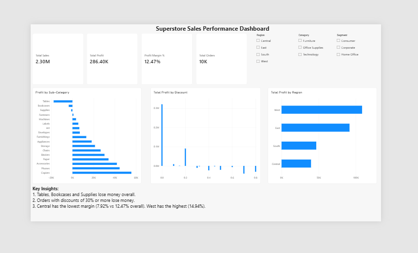
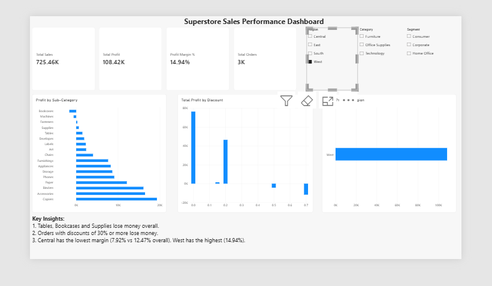

# Superstore Sales Dashboard (Power BI)

An interactive Power BI dashboard built on 10K retail orders from the Superstore sales dataset, using Power Query and DAX measures.

## Dashboard

## What's in it
- 4 KPI cards: Total Sales, Total Profit, Profit Margin %, Total Orders (DAX measures)
- Charts: profit by sub-category, profit by discount level, profit by region
- Slicers for Region, Category and Segment

## Key Insights
1. Tables, Bookcases and Supplies lose money overall.
2. Orders with discounts of 30% or more lose money.
3. Central has the lowest profit margin (7.92% vs 12.47% overall). West has the highest (14.94%).

## Tools
Power BI Desktop, Power Query, DAX
